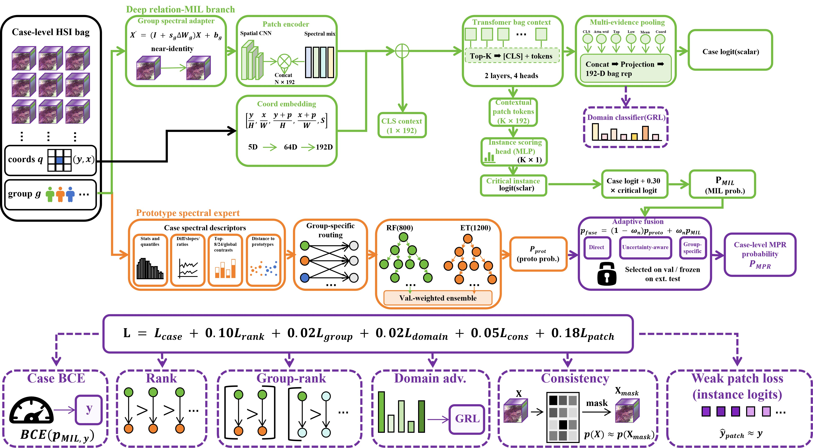

# SPAR-MIL

SPAR-MIL is a multiple-instance learning model for case-level classification of hyperspectral pathology images. This repository provides the model architecture and forward interface.

This repository includes:

- a dual-branch spectral-spatial patch encoder;
- coordinate-aware relation modeling with gated-attention MIL pooling;
- a case-level binary classification head with patch attention outputs;
- a minimal synthetic-data example for interface validation.

## Architecture



## Requirements

- Python 3.10+
- PyTorch 2.1+

Installation:

```bash
python -m venv .venv
# Windows PowerShell
.venv\Scripts\Activate.ps1
pip install -e .
```

Run the minimal example:

```bash
python examples/smoke_test.py
```

## Inputs and outputs

```python
from spar_mil import SPARMIL

model = SPARMIL(input_channels=16)
output = model(patches, coordinates, valid_mask)
```

- `patches`: `[B, N, C, H, W]`, representing batch size, number of patches, spectral channels, height, and width;
- `coordinates`: `[B, N, 2]`, containing patch-center coordinates normalized to `[0, 1]`;
- `valid_mask`: optional Boolean tensor of shape `[B, N]`; `True` marks a valid patch;
- `output.logits`: case-level logits with shape `[B]`;
- `output.attention`: patch attention weights with shape `[B, N]`;
- `output.instance_logits`: auxiliary patch-level logits with shape `[B, N]`.

Default parameter values are provided for interface demonstration.

See [LICENSE](LICENSE) for the terms of use. Public visibility does not grant permission to copy, modify, redistribute, or use this code commercially.

